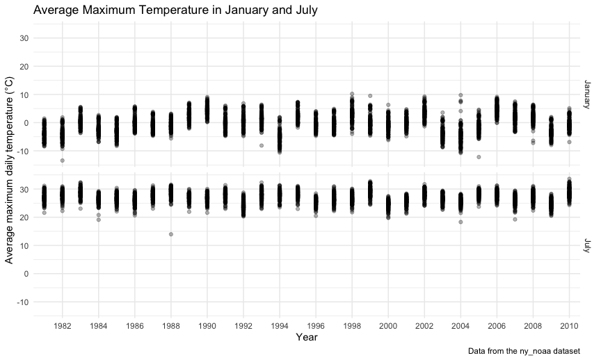
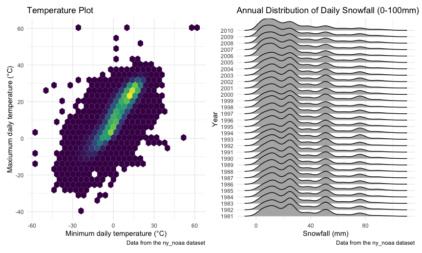
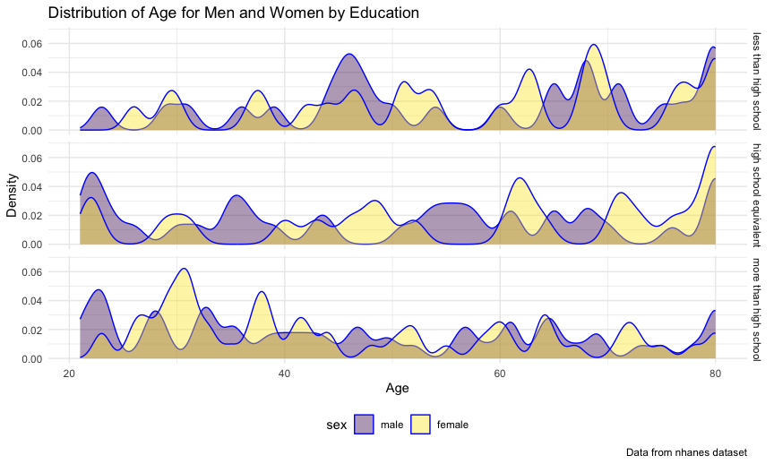

Homework 3 (p8105)
================
Sanyu Takirambudde (stt2133)
2026-10-19

## Problem 1: NY NOAA

### Load `ny_noaa` Dataset

``` r
library(p8105.datasets)
data("ny_noaa")
```

### Data Description

The `ny_noaa` dataset provides daily weather data from 1981-01-01 to
2010-12-31 in different locations in New York, resulting in 2595176
total observations. There are 7 variables in the dataset, including the
weather station ID (`id`), daily precipitation (`prcp`), daily snowfall
(`snow`), daily snow depth (`snwd`), and maximum and minimum daily
temperature (`tmax`, `tmin`). Among all observation in the dataset,
there is 0% and 0% missing data in regards to weather station ID (`id`)
and date (`date`) of observation, respectively. However, there is more
extensive missing data in regard to the other weather-related values.
Specifically, among all observations in the `ny_noaa` dataset 5.62% of
precipitation (`prcp`) data is missing, 14.69% of snowfall (`snow`) data
is missing, 22.8% of snow depth (`snwd`) data is missing, 43.71% of
maximum temperature (`tmax`) data is missing, and 43.71% of minimum
temperature (`tmin`) data is missing.

### Data Cleaning

``` r
noaa = ny_noaa |>
  separate(date, into = c("year", "month", "day"), "-") |>
  mutate(
    prcp = as.numeric(prcp)/10,
    tmax = as.numeric(tmax)/10,
    tmin = as.numeric(tmin)/10
    )
```

``` r
snow_freq_df = noaa |>
  group_by(snow) |>
  summarise(n_obs = n()) |>
  mutate(snow_freq_rank = min_rank(desc(n_obs)))
```

For snowfall, the most common value of `0` mm occurred across 2008508
observations. This is due to the fact that it does not snow on most days
of the year and usually only during certain months of the year. The
second most common value of `NA` occurred across 381221 observations.
This is due to the fact that some weather stations only recorded
precipitation data.

### Average `tmax` Plot

``` r
noaa |>
  filter(month == "01" | month == "07") |>
  group_by(id, month, year) |>
  summarize(mean_tmax = mean(tmax, na.rm=TRUE)) |>
  mutate(
    month = case_match(month, 
                      "01" ~ "January", 
                      "07" ~ "July")
    ) |>
  ggplot(aes(x = year, y = mean_tmax)) +
  geom_point(alpha = 0.3) +
  facet_grid(month ~ .) +
  labs(
    title = "Average Maximum Temperature in January and July",
    x = "Year",
    y = "Average maximum daily temperature (°C)",
    caption = "Data from the ny_noaa dataset") +
  scale_x_discrete(
    breaks = c(1982, 1984, 1986, 1988, 1990, 1992, 1994, 1996, 1998, 2000, 2002, 2004, 2006, 2008, 2010), 
    labels = c("1982", "1984", "1986", "1988", "1990", "1992", "1994", "1996", "1998", "2000", "2002", "2004", "2006", "2008", "2010"))
## Warning: There was 1 warning in `mutate()`.
## ℹ In argument: `month = case_match(month, "01" ~ "January", "07" ~ "July")`.
## ℹ In group 1: `id = "US1NYAB0001"`, `month = "01"`.
## Caused by warning:
## ! `case_match()` was deprecated in dplyr 1.2.0.
## ℹ Please use `recode_values()` instead.
## Warning: Removed 5970 rows containing missing values or values outside the scale range
## (`geom_point()`).
```



Visually inspecting the maximum temperature plot indicates that January
is generally colder with lower `mean_tmax` temperatures and July is
warmer with higher `mean_tmax` temperatures. There are noticeable
outliers with one weather station reporting on average a cold July in
1988 of roughly 14 degrees Celcius `mean_tmax`, as well as one weather
station reporting a particularly cold January in 1982 on average of
roughly -4 degrees Celsius `mean_tmax`.

### `tmax` vs `tmin` Plot & Snowfall Distribution Plot

``` r
ggp_tmax_tmin = noaa |>
  ggplot(aes(x = tmin, y = tmax)) +
  geom_hex() +
  labs(
    title = "Temperature Plot",
    x = "Minimum daily temperature (°C)",
    y = "Maxiumum daily temperature (°C)",
    caption = "Data from the ny_noaa dataset") +
  theme(legend.position = "none")

ggp_snow_ridge = noaa |> 
  filter(snow > 0 & snow < 100) |>
  ggplot(aes(x = snow, y = year)) + 
  geom_density_ridges(scale = 2) +
  labs(
    title = "Annual Distribution of Daily Snowfall (0-100mm)",
    x = "Snowfall (mm)",
    y = "Year",
    caption = "Data from the ny_noaa dataset")

ggp_tmax_tmin + ggp_snow_ridge
## Warning: Removed 1136276 rows containing non-finite outside the scale range
## (`stat_binhex()`).
```



## Problem 2: MIMS

### Load, tidy and merge `mims_demos` and `mims_accel`

``` r
mims_demos = 
  read_csv("data/nhanes_covar.csv", 
           skip = 4,
           na = c("NA")) |>
  janitor::clean_names() |>
  mutate(
    seqn = as.character(seqn),
    sex = case_match(sex, 
                     1 ~ "male", 
                     2 ~ "female"),
    sex = factor(sex, levels = c("male", "female")),
    education = case_match(education, 
                           1 ~ "less than high school",
                           2 ~ "high school equivalent",
                           3 ~ "more than high school"),
    education = factor(education, 
                       levels = c("less than high school", 
                                  "high school equivalent", 
                                  "more than high school")
                       )
    )

mims_accel = 
  read_csv("data/nhanes_accel.csv")|>
  janitor::clean_names() |>
  mutate(seqn = as.character(seqn)) |>
  pivot_longer(
    min1:min1440,
    names_to = "min", 
    names_prefix = "min",
    values_to = "mims")
```

### Merge `mims_demos` and `mims_accel` into `mims`

``` r
mims = left_join(mims_demos, mims_accel, by = "seqn") |>
       select(seqn, min, mims, everything()) |>
       filter(age > 20 & !is.na(sex) & !is.na(age) & 
              !is.na(bmi) & !is.na(education))
```

### N men and women by education

``` r
mims_sex_edu = mims |> 
  group_by(education, sex) |>
  summarise(count = n())

knitr::kable(mims_sex_edu, digits = 2)
```

| education              | sex    | count |
|:-----------------------|:-------|------:|
| less than high school  | male   | 38880 |
| less than high school  | female | 40320 |
| high school equivalent | male   | 50400 |
| high school equivalent | female | 33120 |
| more than high school  | male   | 80640 |
| more than high school  | female | 84960 |

### Age distribution for men and women by education

``` r
mims |> 
  ggplot(aes(x = age, fill = sex)) + 
  geom_density(alpha = .4, adjust = .5, color = "blue") +
  facet_grid(education ~ .) +
  labs(
    title = "Distribution of Age for Men and Women by Education",
    x = "Age",
    y = "Density",
    caption = "Data from nhanes dataset")
```



Based on the `mims_sex_edu` table, the combination of
`more than high school` and `female` represents the most highest
frequency in the `mims` dataset with `84960` observations, closely
followed by the combination of `more than high school` and `male` with
`80640` observations. The least frequent combinations of `education` and
`sex` was `high school equivalent` and `female` with 33120 observations
and `less than high school` and `male` with 38880 observations.

Based on the **Distribution of Age for Men and Women by Education**
density plots, observations associated with individuals with
`more than high school` education were more frequently younger than
older. Among observations associated with females with a
`more than high school` education, they were most frequently
approximately 30 years old, while males with `more than high school`
education, they were most frequently approximately 21-22 years old.
Among observations associated with males with a `high school equivalent`
education, the density plot indicates a bimodal distribution, with
highest frequencies at opposite end of the `age` spectrum, around 21-22
years old (similarly to male observations with a `more than high school`
education) and 80 years old. Among `less than high school` observations,
there appears to be a contrasting distribution compared to the one
previously described in regard to `more than high school` education
observation. Specifically, those observations tended to associated with
older individuals. Within the `less than high school` education stratum,
female observations were comparatively older with modes at 68 years old
and 80 years old. Conversely with that same stratum, male observations
had several modes, most noticable at 43, 67, and 79 years old.

### Aggregate `mims` across `min` to create `total_mims` and plot `total_mims` by `age`

``` r
mims |>
  group_by(seqn, sex, age, education) |>
  summarize(total_mims = sum(mims)) |>
  ggplot(aes(x = age, y = total_mims, color = sex)) +
  geom_point() +
  geom_smooth(se = FALSE) +
  facet_grid(education ~ .) +
  labs(
    title = "Scatterplot of Total Activity by Age",
    x = "Age",
    y = "Total Activity",
    caption = "Data from nhanes dataset")
```


Based on the **Scatterplot of Total Activity by Age**, we can appreciate
potential differencea in total activity (`total_mims`) across the `age`
range of participants, according to `sex` and `education`. It would
appear that total activity generally decreases as `age` of participants
increase. This trend is indicated in each of the three `education`
categories. This association seems to be most noticeable within the
`less than high school` stratum. In only the `less than high school`
stratum of `education`, `male` participants seem to have recorded higher
total activity. Conversely, in the other two strata of `education`,
namely `high school equivalent` and `more than high school`, `female`
participants generally recorded higher total activity. Across all
`education` strata, it would appear that participants with
`less than high school` recorded amongst the highest total activity,
especially those that were younger in `age`.

### 24-hour activity time courses for each education level by sex

``` r
mims |> 
  mutate(min = as.numeric(min)) |>
  ggplot(aes(x = min, y = mims, color = sex)) +
  geom_line(aes(group = seqn), alpha = 0.1) +
  geom_smooth(aes(group = sex), size = 1, se = FALSE) +
  facet_grid(education ~ .) +                  
  labs(
    title = "24-hr Activity Time Course Plot",
    x = "Time",
    y = "MIMS",
    color = "Sex",
    caption = "Data from nhanes dataset") +
  scale_x_continuous(
    breaks = c(0,   240,    480,    720,    960,    1200,   1440), 
    labels = c("12 AM", "4 AM", "8 AM", "12 PM",    "4 PM", "8 PM", "12 AM"))
## Warning: Using `size` aesthetic for lines was deprecated in ggplot2 3.4.0.
## ℹ Please use `linewidth` instead.
## This warning is displayed once per session.
## Call `lifecycle::last_lifecycle_warnings()` to see where this warning was
## generated.
```


Based on the smooth trends in the **24-hr Activity Plot**, we can
appreciate several patterns across the time period overall, according to
`education` category and according to `sex`. Overall, `mims` values are
lowest from 12 AM (`min` = `1`) until 6 AM (`min` = `360`). Thereafter
`mims` values increase until 10 AM (`min` = `600`), after which they
plateau at `mims` = `10`-`14` for most of the day. `mims` values then
seem to decrease, most precipitously from 8 PM (`min` = `1200`), up
until the end of the time period (12 PM, `min` = `1400`). Regarding
differences related to `education` participants with
`less than high school` appear to have the highest peaks of `mims` =
`15` at 11:30 AM (`min` = `690`) for `female` participants and `mims` =
`14` at 12 PM (`min` = `720`) for `male` participants. `female`
participants with `less than high school` actually also have the lowest
trough of `mims` less than `1` at 4 AM (`min` = `240`). Within this same
`education` stratum, we see the greatest difference in lowest trough
between `sex`, as `male` participants with `less than high school`
having their lowest trough of `mims` = `2` also at 4 AM (`min` = `240`).
Within the other two `education` categories, there does not seem to be
an appreciable difference between the lowest `mims` value between `sex`
categories. Speaking to `sex` differences in `mims` values overall, in
the `high school equivalent` and `more than high school` stratum of
`education`, `male` participants generally have lower `mims` values than
`female` participants across the 24-hr time period, especially with
respect to daytime observations as opposed to nighttime observations.
This difference is most noticeable in the `more than high school`
stratum of `education`. This is not to suggest that the pattern does not
hold within the `less than high school` stratum of `education`, but the
difference is simply less pronounced upon visual inspection of the
smooth trends.
