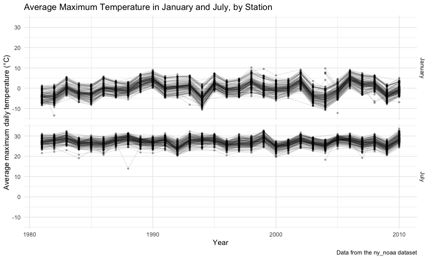
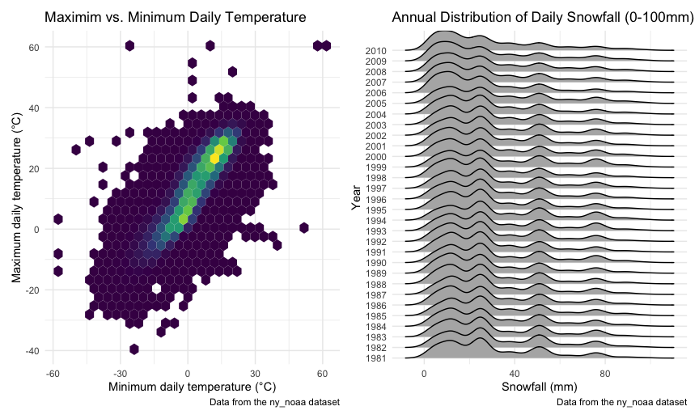
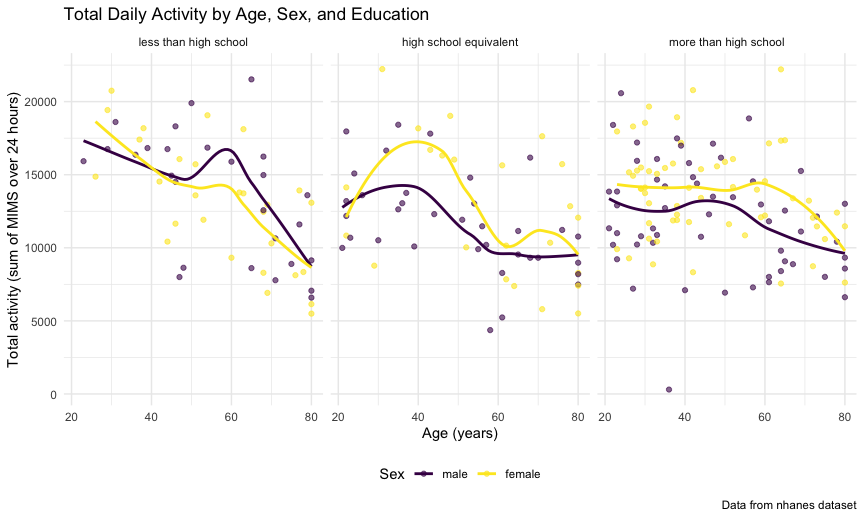
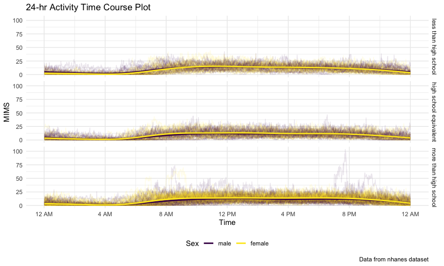
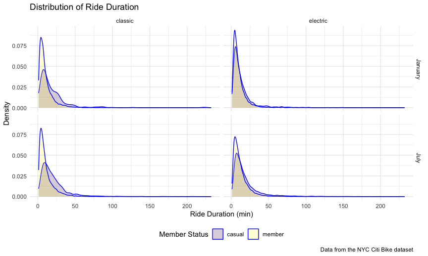

Homework 3 (p8105)
================
Sanyu Takirambudde (stt2133)
2026-10-19

# Problem 1: NY NOAA

## 1.0. Load `ny_noaa` Dataset

``` r
library(p8105.datasets)
data("ny_noaa")
```

## 1.1. Data Description

The `ny_noaa` dataset contains daily weather data from 1981-01-01 to
2010-12-31 in 747 different weather stations across New York State,
resulting in 2595176 total observations (one row per weather station per
day). There are 7 variables in the dataset: the weather station ID
(`id`), the date of observation (`date`), daily precipitation (`prcp`,
in tenths of mm), daily snowfall (`snow`, in mm), daily snow depth
(`snwd`, in mm), and maximum and minimum daily temperature (`tmax` and
`tmin`, in tenths of a degreee Celcuius). Weather station ID and date
are never missing, but missing data is a substantial issue for the
weather measurements: 5.62% of precipitation values, 14.69% of snowfall
values, 22.8% of snow depth values, and 43.71% and 43.71% of respective
maximum and minimum temperature values are missing.

## 1.2. Data Cleaning

``` r
noaa = ny_noaa |>
  separate(date, into = c("year", "month", "day"), "-") |>
  mutate(
    prcp = prcp/10,
    tmax = as.numeric(tmax)/10,
    tmin = as.numeric(tmin)/10,
    year = as.numeric(year),
    month = as.numeric(month),
    day = as.numeric(day)
    )
```

After cleaning the `ny_noaa` dataset, `year`, `month`, and `day` are
separate numeric variables. Precipitation was converted from tenths of
mm to mm, and maximum and minimum temperature were converted from tenths
of a degree to degrees Celsius.

## 1.3. Frequency of `snowfall` Values

``` r
snow_freq_df = noaa |>
  group_by(snow) |>
  summarise(n_obs = n()) |>
  mutate(snow_freq_rank = min_rank(desc(n_obs)))
```

For snowfall, the most common value of `0` mm occurred across 2008508
observations. This is due to the fact that it does not snow on most days
of the year and usually only during certain months of the year. The
second most common value of `NA` occurred across 381221 observations.
This is due to the fact that some weather stations only recorded
precipitation data. The next most common values are 25, 13, 13, and 51
mm. These correspond to 1, 0.5, 2, and 3 inches, which suggests that
many weather stations measure snowfall in inches and the values were
converted to mm afterward.

## 1.4. Average `tmax` in January and July

``` r
noaa |>
  filter(month == 1 | month == 7) |>
  group_by(id, month, year) |>
  summarize(mean_tmax = mean(tmax, na.rm=TRUE)) |>
  mutate(
    month = case_match(month, 
                      1 ~ "January", 
                      7 ~ "July")
    ) |>
  ggplot(aes(x = year, y = mean_tmax, group = id)) +
  geom_point(alpha = 0.3, size = .8) +
  geom_line(alpha = .1) +
  facet_grid(month ~ .) +
  labs(
    title = "Average Maximum Temperature in January and July, by Station",
    x = "Year",
    y = "Average maximum daily temperature (°C)",
    caption = "Data from the ny_noaa dataset")
## Warning: There was 1 warning in `mutate()`.
## ℹ In argument: `month = case_match(month, 1 ~ "January", 7 ~ "July")`.
## ℹ In group 1: `id = "US1NYAB0001"`, `month = 1`.
## Caused by warning:
## ! `case_match()` was deprecated in dplyr 1.2.0.
## ℹ Please use `recode_values()` instead.
## Warning: Removed 5970 rows containing missing values or values outside the scale range
## (`geom_point()`).
## Warning: Removed 5932 rows containing missing values or values outside the scale range
## (`geom_line()`).
```



Visually inspecting the \*Average Maximum Temperature in January and
July, by Station\*\* indicates that `January` is consistently much
colder than July. Most weather station’s `tmax` averages fall between
about -10°C and 10°C in January and between about 20°C and 33°C in July.
There is clear year-to-year structure, since average maximum
temperatures of stations tend to rise and fall together. For example,
January was unusually cold across most stations in 1994 and 2004 and
unusually warm in 1990 and 2006. January averages also vary more between
years than July averages. There are a few noticeable outliers, including
one weather station with an average July maximum of only about 14°C in
1988, and two with average January maximums of about -13°C (1982) and
-12°C (2005).

## 1.5. `tmax` vs. `tmin`; Snowfall Distribution

``` r
ggp_tmax_tmin = noaa |>
  ggplot(aes(x = tmin, y = tmax)) +
  geom_hex() +
  labs(
    title = "Daily Maximum vs. Minimum Temperature",
    x = "Minimum daily temperature (°C)",
    y = "Maximum daily temperature (°C)",
    fill = "Number of days",) +  
    theme(legend.text = element_text(angle = 90))

ggp_snow_ridge = noaa |> 
  filter(snow > 0 & snow < 100) |>
  ggplot(aes(x = snow, y = factor(year))) + 
  geom_density_ridges(scale = 2) +
  labs(
    title = "Daily Snowfall (0-100 mm) by Year",
    x = "Snowfall (mm)",
    y = "Year",
    caption = "Data from the ny_noaa dataset")

ggp_tmax_tmin + ggp_snow_ridge
## Warning: Removed 1136276 rows containing non-finite outside the scale range
## (`stat_binhex()`).
```



Maximum and minimum daily temperature are strongly and positively
related. The most frequent `tmax` and `tmin` combinations are in the
range of about (-10°C, 0°C) to (20°C, 30°C), with `tmax` usually about
5-15°C warmer than `tmin`. There are a few outliers that seem
implausible and might be a result of measurement errors. For example,
there are days with `tmax` values of 60°C, and 1183 days have a `tmin`
greater than `tmax`.

The distribution of daily snowfall (excluding days with no snow) looks
consistent from year to year. In every year, most snowfall days have
less than about 30 mm of `snow`, and the distributions have peaks at
about 13, 25, 51, and 76 mm, which matches the measurements-by-inch and
conversion to mm approach alluded to earlier.

# Problem 2: MIMS

## 2.1. Load, tidy, merge into `mims`

``` r
mims_demos = 
  read_csv("data/nhanes_covar.csv", 
           skip = 4,
           na = c("NA")) |>
  janitor::clean_names() |>
  filter(age >= 21) |>
  drop_na() |>
  mutate(
    seqn = as.character(seqn),
    sex = case_match(sex, 
                     1 ~ "male", 
                     2 ~ "female"),
    sex = factor(sex, levels = c("male", "female")),
    education = case_match(education, 
                           1 ~ "less than high school",
                           2 ~ "high school equivalent",
                           3 ~ "more than high school"),
    education = factor(education, 
                       levels = c("less than high school", 
                                  "high school equivalent", 
                                  "more than high school")
                       )
    )

mims_accel = 
  read_csv("data/nhanes_accel.csv")|>
  janitor::clean_names() |>
  mutate(seqn = as.character(seqn)) |>
  pivot_longer(
    min1:min1440,
    names_to = "minute", 
    names_prefix = "min",
    values_to = "mims"
    ) |>
  mutate(minute = as.integer(minute))

mims = left_join(mims_demos, mims_accel, by = "seqn") |>
       select(seqn, minute, mims, everything())
```

## 2.2. `mims` Data Visualization

### 2.2.1. Frequency by `sex` & `education`

``` r
mims |> 
  distinct(seqn, sex, education) |>
  count(education, sex) |>
  pivot_wider(
    names_from = sex,
    values_from = n
  ) |>
  knitr::kable()
```

| education              | male | female |
|:-----------------------|-----:|-------:|
| less than high school  |   27 |     28 |
| high school equivalent |   35 |     23 |
| more than high school  |   56 |     59 |

Based on the frequency table, the largest `education` group is more than
high school, with similar numbers of males and females. The less than
high school `education` group is similarly fairly balanced between males
and females but there is a slightly larger discrepancy. The high school
equivalent `education` group is the least balanced, with noticeably more
men than women.

### 2.2.2. Distribution of `age` by `sex` & `education`

``` r
mims |> 
  ggplot(aes(x = age, fill = sex)) + 
  geom_density(alpha = .4, color = "blue") +
  facet_grid(education ~ .) +
  labs(
    title = "Distribution of Age for Men and Women by Education",
    x = "Age",
    y = "Density",
    fill = "Sex",
    caption = "Data from NHANES")
```


Based on the **Distribution of Age for Men and Women by Education**
density plots, participants with more than high school `education` tend
to be younger, and women in this group are especially concentrated in
their 30s. Participants with less than high school `education` tend to
be older, and the `age` distributions of men and women in this group are
similar. In the high school equivalent `education` group, men are spread
fairly evenly across ages, while women are concentrated at older ages.

## 2.3. Total Activity

``` r
mims |>
  group_by(seqn, sex, age, education) |>
  summarize(total_mims = sum(mims)) |>
  ggplot(aes(x = age, y = total_mims, color = sex)) +
  geom_point(alpha = .6) +
  geom_smooth(se = FALSE) +
  facet_grid(. ~ education) +
  labs(
    title = "Total Daily Activity by Age, Sex, and Education",
    x = "Age (years)",
    y = "Total activity (sum of MIMS over 24 hours)",
    color = "Sex",
    caption = "Data from nhanes dataset")
```



In all three `education` groups, total activity tends to decline with
`age`, especially after about 60 years. This decline is steepest among
participants with less than high school `education.` In that group
females are slightly more active than males at younger ages, while males
are more active between about ages older than 50. In the high school
equivalent and more than high school `education` groups, females tend to
have higher total activity than males across most of the `age` range,
and the difference is largest between about ages 30 and 50 in the high
school equivalent group. One man in the more than high school group has
a total activity close to zero.

## 2.4. 24-hour Activity Time Courses

### 2.4.1. `mims` Time Course Plot

``` r
mims |> 
  ggplot(aes(x = minute, y = mims, color = sex)) +
  geom_line(aes(group = seqn), alpha = 0.1) +
  geom_smooth(aes(group = sex), size = 1, se = FALSE) +
  facet_grid(education ~ .) +                  
  labs(
    title = "24-hr Activity Time Course Plot",
    x = "Time",
    y = "MIMS",
    color = "Sex",
    caption = "Data from nhanes dataset")
## Warning: Using `size` aesthetic for lines was deprecated in ggplot2 3.4.0.
## ℹ Please use `linewidth` instead.
## This warning is displayed once per session.
## Call `lifecycle::last_lifecycle_warnings()` to see where this warning was
## generated.
```



### 2.4.2. Patterns and Conclusions

Based on the smooth trends in the **24-hr Activity Plot**, we can
appreciate several patterns across the time period overall, according to
`education` category and according to `sex`. Overall, `mims` values are
lowest from 12 AM (`min` = `1`) until 6 AM (`min` = `360`). Thereafter
`mims` values increase until 10 AM (`min` = `600`), after which they
plateau at `mims` = `10`-`14` for most of the day. `mims` values then
seem to decrease, most precipitously from 8 PM (`min` = `1200`), up
until the end of the time period (12 PM, `min` = `1400`). Regarding
differences related to `education` participants with
`less than high school` appear to have the highest peaks of `mims` =
`15` at 11:30 AM (`min` = `690`) for `female` participants and `mims` =
`14` at 12 PM (`min` = `720`) for `male` participants. `female`
participants with `less than high school` actually also have the lowest
trough of `mims` less than `1` at 4 AM (`min` = `240`). Within this same
`education` stratum, we see the greatest difference in lowest trough
between `sex`, as `male` participants with `less than high school`
having their lowest trough of `mims` = `2` also at 4 AM (`min` = `240`).
Within the other two `education` categories, there does not seem to be
an appreciable difference between the lowest `mims` value between `sex`
categories. Speaking to `sex` differences in `mims` values overall, in
the `high school equivalent` and `more than high school` stratum of
`education`, `male` participants generally have lower `mims` values than
`female` participants across the 24-hr time period, especially with
respect to daytime observations as opposed to nighttime observations.
This difference is most noticeable in the `more than high school`
stratum of `education`. This is not to suggest that the pattern does not
hold within the `less than high school` stratum of `education`, but the
difference is simply less pronounced upon visual inspection of the
smooth trends.

# Problem 3: Citi Bike

## 3.1. Import, Clean, Tidy, and Merge `citi` Data

``` r
citi0120 = 
  read_csv("data/Jan 2020 Citi.csv", na = c("NA")) |>
  mutate(month = "January",
         year = "2020")

citi0720 = 
  read_csv("data/July 2020 Citi.csv", na = c("NA")) |>
  mutate(month = "July",
         year = "2020")

citi0124 = 
  read_csv("data/Jan 2024 Citi.csv", na = c("NA")) |>
  mutate(month = "January",
         year = "2024")

citi0724 = 
  read_csv("data/July 2024 Citi.csv", na = c("NA")) |>
  mutate(month = "July",
         year = "2024")

citi = 
  bind_rows(citi0120, citi0720, citi0124, citi0724) |>
  mutate(
    bike_type = case_match(rideable_type,
                           "classic_bike" ~ "classic", 
                           "electric_bike" ~ "electric"),
    bike_type = as.factor(bike_type),
    weekday = factor(weekdays, levels = str_c(c("Mon", "Tues", "Wednes", "Thurs", "Fri", "Satur", "Sun"), "day")),
    member_status = as.factor(member_casual),
    month = as.factor(month),
    year = as.factor(year)) |>
    select(-rideable_type, -weekdays, -member_casual)
```

## 3.2. `citi` Data Description

`citi` contains data on rides taken on the NYC Citi Bike system in
January and July of 2020 and 2024. The dataset includes information on a
total of 99485 rides. There are 9 variables in this dataset, including
unique ride ID, duration of ride, names of the start and end station of
the ride, type of bike used for the ride, membership status of the
associated rider, and each ride’s year, month and day of week.

## 3.3. Frequency by `year`, `month`, & `member_status`

### 3.3.1. Tables

``` r
citi |>
  group_by(year, month, member_status) |>
  summarize(rides = n()) |>
  knitr::kable()
```

| year | month   | member_status | rides |
|:-----|:--------|:--------------|------:|
| 2020 | January | casual        |   984 |
| 2020 | January | member        | 11436 |
| 2020 | July    | casual        |  5637 |
| 2020 | July    | member        | 15411 |
| 2024 | January | casual        |  2108 |
| 2024 | January | member        | 16753 |
| 2024 | July    | casual        | 10894 |
| 2024 | July    | member        | 36262 |

### 3.3.2. Comments

Based on the frequency table, across the years and months observed, Citi
Bike members took more rides than casual riders. The `member_status`
category that had the combination of years and months recording the
greatest frequency were also members and this occurred in `July` of
`2024` with 36262 rides. Conversely, the `member_status` category that
had the combination of years and months recording the lowest frequency
were casual riders and this occurred in `January` of `2020` with 984
rides.

## 3.4. Frequency among Popular Stations in July 2024

``` r
citi |>
  filter(month == "July" & year == "2024") |>
  group_by(start_station_name) |>
  summarize(rides = n()) |>
  mutate(ride_freq_rank = min_rank(desc(rides))) |>
  filter(ride_freq_rank < 6) |>
  select(-ride_freq_rank) |>
  knitr::kable()
```

| start_station_name       | rides |
|:-------------------------|------:|
| Pier 61 at Chelsea Piers |   163 |
| University Pl & E 14 St  |   155 |
| W 21 St & 6 Ave          |   152 |
| W 31 St & 7 Ave          |   146 |
| West St & Chambers St    |   150 |

## 3.5. Effects of `week_day`, `month`, & `year` on `median_duration`

### 3.5.1. Plot

``` r
citi |>
  group_by(year, month, weekday) |>
  summarize(median_duration = median(duration)) |>
  ggplot(aes(x = weekday, y = median_duration, group = month, color = month)) +
  geom_point() + 
  geom_line() +
  facet_grid(year ~ .) +
  labs(
    title = "Median Ride Duration by Day of the Week, Month, & Year",
    x = "Day of the Week",
    y = "Median Duration of Ride",
    caption = "Data from NYC Citi Bike dataset")
```


### 3.5.2. Comments

The plot allows us to investigate the effects of day of the week, month,
and year on median ride duration. In `January` of `2024`,
`median_duration` was quite relatively consistent throughout the weak,
albeit trending upwards from a low of just under `7.5` minutes on
`Tuesday` to a high of ~`8` minutes on `Saturday`. On the other hand, in
`July` of `2020`, we see a marked difference in `median_duration` across
the week, from ~`13` minutes on `Friday` all the way to over `16`
minutes over the weekend days of `Saturday` and `Sunday`. That same
trend can be appreciated to less exaggerated degree in the other two
combinations of `month` and `year`, namely `January` of `2020` and
`July` of `2024`, with noticeably higher `median_duration` of rides on
`Saturday` and `Sunday`. As alluded to previously, `July` of `2020` saw
the highest `median_duration` values across the week, while `January` of
`2024` saw the lowest. This leads me to mentioning a clear pattern in
`median_duration` of rides in `January` vs `July`. Median duration of
rides was higher in `July` than `January`, particularly over the
weekends, as mentioned.

## 3.6. Impact of `month`, `member_status`, & `bike_type` on `duration` Distribution

### 3.6.1. Plot

``` r
citi |>
  filter(year == "2024") |>
  ggplot(aes(x = duration, fill = member_status)) +
  geom_density(alpha = .2, adjust = 1, color = "blue") +
  facet_grid(month ~ bike_type) + 
  labs(
    title = "Distribution of Ride Duration",
    x = "Ride Duration (min)",
    y = "Density",
    fill = "Member Status",
    caption = "Data from the NYC Citi Bike dataset"
  )
```



### 3.6.2. Comments

Based on the density plots, the most stark difference is the
distributions of ride `duration` between the two categories of
`member_status` among rides taken on `classic` bikes. This difference
seems to be that rides taken on `classic` bikes by members are more
frequently shorter than rides by casual riders. Otherwise, all 8 of the
density plots appear quite right-skewed, with most `duration` values on
the short end.
